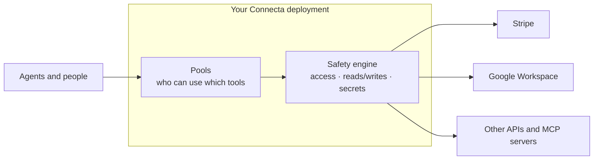
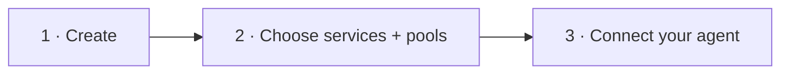

# connecta

**One connection between your agent and the services you choose.**

Connecta puts MCP servers and HTTP APIs behind one MCP endpoint that you run
yourself. Connect an agent once, then choose which services it can use.



The agent can call one tool or run a short JavaScript program to gather,
combine, and trim results before they enter the conversation. Service
credentials stay inside Connecta.

## What you can connect

Maintained connections: <!-- providers:start -->Breeze ChMS, Church Community Builder, Cloudflare, GitHub, Gmail, Google Docs, Google Drive, Google Forms, Google Sheets, Google Slides, Overflow, Planning Center, Stripe, Tithe.ly, and Vercel<!-- providers:end -->.

Connect any other hosted MCP server through `remoteMcp()`, or describe an
HTTP API through `api()`. Hosted connections discover the server's current
tools; maintained providers wrap vendor APIs.

## What it protects

| Boundary         | What Connecta does                                                                                |
| ---------------- | ------------------------------------------------------------------------------------------------- |
| Access           | A pool limits the tools its members can reach.                                                    |
| Writes           | Connecta never automatically sends a dispatched write again. An uncertain outcome needs checking. |
| Secrets          | Service credentials stay on the server; known secrets are redacted from agent output.             |
| Read-only access | Read-only endpoints hide writes and refuse attempts to call them.                                 |

Your agent's host owns approvals. A writable pool can write without a person
if its host permits it. [Safety and trust](./guides/safety-and-trust.md)
explains the boundaries and limits.

## Try it in three steps

1. **Create a deployment.** Start with the Node template:

   ```sh
   npx @zackbart/connecta init my-connecta
   cd my-connecta
   npm install
   ```

2. **Choose services and access.** Give your setup agent the
   [operator documentation](./documentation/README.md) and tell it which
   services, people, and agents need access. It configures connectors and
   pools, connects credentials, and starts the server.
3. **Connect a client.** Give the client its pool's endpoint and credential.
   [Connecting agents](./guides/connecting-agents.md) explains the choices;
   the [deployment guide](./documentation/deploying.md) has runnable steps.



The package is `@zackbart/connecta` (`npm install @zackbart/connecta`). Run it
on Node, in Docker, or on Cloudflare Workers. The
[deployment guide](./documentation/deploying.md#choose-a-deployment) covers each.

## Read a little more

| Guide                                               | What you'll understand                                                 |
| --------------------------------------------------- | ---------------------------------------------------------------------- |
| [How it works](./guides/how-it-works.md)            | Connectors, pools, people, and how a call reaches a service.           |
| [Connecting agents](./guides/connecting-agents.md)  | Agent tokens, Vercel identity, and the Eve helper.                     |
| [Safety and trust](./guides/safety-and-trust.md)    | Write outcomes, secrets, read-only access, and your responsibilities.  |
| [Operator documentation](./documentation/README.md) | Exact setup steps and contracts for the agent running your deployment. |

**Coming in 0.35.0:** Vercel workload identity and the separate
`@zackbart/connecta-eve` helper are merged on main and await publication.
Native tools for clients with their own tool search are planned for that
release and remain pending in [#977](https://github.com/zackbart/connecta/pull/977).

<a id="existing-client-tokens"></a>

Upgrading? Follow the [upgrade guide](./documentation/deploying.md#upgrade-an-existing-deployment).
Breaking changes are expected before 1.0. See the [changelog](./CHANGELOG.md)
and [security policy](./SECURITY.md).
