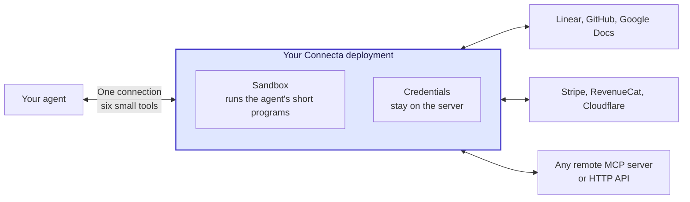
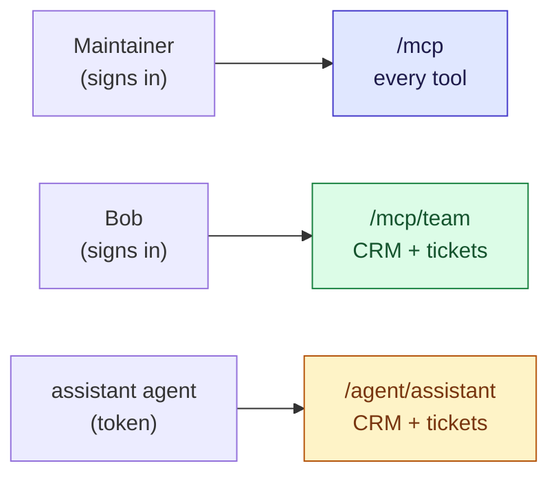
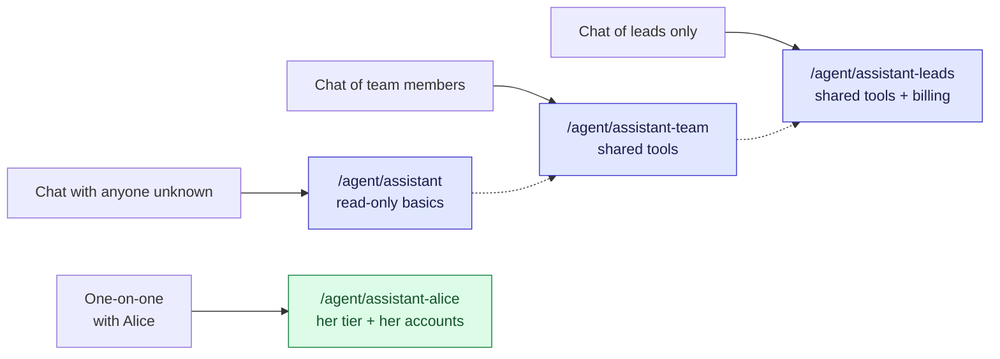

# connecta

**One connection between your agent and the services you choose.**

Connecta puts your MCP servers and HTTP APIs behind one endpoint that you run
yourself. Connect your agent once; decide in code who can reach what.

## How it works

The agent doesn't load every service's tools into the conversation. It writes
a short program that gathers, joins, and trims results inside Connecta, so
only the answer comes back.

## What you can connect

Maintained connections: <!-- providers:start -->Breeze ChMS, Church Community Builder, Cloudflare, GitHub, Gmail, Google Docs, Google Drive, Google Forms, Google Sheets, Google Slides, Overflow, Planning Center, Stripe, Tithe.ly, and Vercel<!-- providers:end -->.
Maintained providers wrap vendor APIs. Hosted MCP servers use generic connections
that discover the vendor's current tools at runtime. You can also describe your
own HTTP APIs.

## Who can use it

|                   | People                                               | Agents                                                    |
| ----------------- | ---------------------------------------------------- | --------------------------------------------------------- |
| What they are     | You and your team                                    | Bots, assistants, CI, scheduled jobs                      |
| How they prove it | Sign in: Clerk (Node) or Cloudflare Access (Workers) | A Connecta token, or Vercel workload identity (prototype) |
| Their own logins  | Yes, on personal connections                         | No. An agent uses accounts you assign it                  |

**Maintainers** are the people who run the deployment: they reach every tool
and manage credentials and agent tokens. Everyone else reaches only the pools
they are listed in.

### Pools

A **pool** is a named set of tools plus a list of who may use it. Each pool
has its own address, and every caller sees exactly that pool's tools.

People use a pool at `/mcp/<pool>` and agents at `/agent/<pool>`. A caller
outside a pool gets the same "not found" as a pool that doesn't exist, and
someone in two pools uses two addresses: pools never merge.

### One agent, many people

An assistant that talks to several people keeps **one machine identity and one
connection**. Its harness, not the model, picks the pool each turn: a chat
gets the most capable tier that everyone in it is cleared for, and a
one-on-one gets that person's own pool.

Each tier builds on the one below it. A person's own pool builds on the
highest tier they are cleared for and holds only the agent, since anyone else
in it would act as that person. A tier can double as a team's own pool for
the people cleared for it. [Organizing an agent's pools](./documentation/auth.md#organizing-an-agents-pools)
has the full layout.

### Whose account a connection uses

- **Shared** (the default): the deployment's account, connected once by a
  maintainer.
- **Personal**: each person's own account. Agents never see these.
- **Google Workspace**: the signed-in person's account; for an agent, the
  owner of a person's pool, or one fixed shared account. Without an owner,
  mapping connections are absent for agents.

## Reads and writes

Every endpoint is writable or read-only, and you choose explicitly. A
read-only endpoint hides write tools and refuses every write. You can also make
one connection read-only across all endpoints. On a writable
one, your agent's host decides what to approve.

## Where it runs

Node or Docker (Clerk sign-in, SQLite) or Cloudflare Workers (Cloudflare
Access, D1, deployed with Alchemy). Both serve the same agent tools. An optional operator UI shows
a connection map, endpoints, connectors, and activity; integrations and access
still change only in deployment code.

## Getting started

Give your agent the [agent documentation](./documentation/README.md) and ask
it to set up Connecta with the integrations you want, where to run it, and who
should have access.

Upgrading? Point your agent at the
[upgrade guidance](./documentation/deploying.md#upgrade-an-existing-deployment).

## Status

Built for its author's deployments first and published openly. Breaking
changes are expected before 1.0. See the [changelog](./CHANGELOG.md) and
[security policy](./SECURITY.md).

[Principles](https://github.com/zackbart/connecta/blob/main/PRINCIPLES.md) ·
[Decision records](https://github.com/zackbart/connecta/tree/main/decisions) ·
[Planned work](https://github.com/zackbart/connecta/issues) (a plan is not a
shipped feature)
