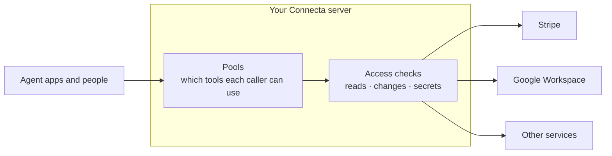
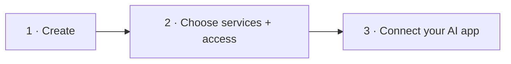

# connecta

**One connection between your agent and the services you choose.**

Connecta puts the services your agent needs behind one connection. It uses
**Model Context Protocol (MCP)**, a standard that lets AI apps use tools.
You run Connecta and choose what each agent may access.



A tool is an action, such as finding a ticket or updating a record. The agent
can call one action directly or combine several in a short program inside
Connecta. The program can return a small answer instead of every record.
Connecta supplies the service credentials, so the agent doesn't need them.

## What you can connect

Maintained connections: <!-- providers:start -->Breeze ChMS, Church Community Builder, Cloudflare, GitHub, Gmail, Google Docs, Google Drive, Google Forms, Google Sheets, Google Slides, Granola, Overflow, Planning Center, QuickBooks Online, Stripe, Tithe.ly, and Vercel<!-- providers:end -->.

Maintained API providers pair reviewed vendor contracts with tools built by
Connecta. See the [API sources and tool inventory](./documentation/providers.md#api-sources-and-tool-inventory)
for each provider's named workflows and reviewed API tools.

You can also connect another hosted MCP tool server through `remoteMcp()`,
which discovers the server's live tool catalog, or describe an API Connecta
should call.

## What it protects

| Boundary         | What Connecta does                                                                                                        |
| ---------------- | ------------------------------------------------------------------------------------------------------------------------- |
| Access           | A pool limits the tools its members can reach.                                                                            |
| Writes           | For tools marked as writes, once a change is sent, Connecta won't automatically send it again.                            |
| Secrets          | Known secrets are redacted from agent output. Enable the credential vault to encrypt stored credentials and OAuth tokens. |
| Read-only access | Read-only endpoints hide writes and refuse attempts to call them.                                                         |

Read-only protection and single-attempt writes depend on truthful tool labels.
The AI app using Connecta decides when to ask for approval; a writable pool
can write unattended. [Safety and trust](./guides/safety-and-trust.md)
explains these boundaries and their limits.

## Try it in three steps

You'll need somewhere to run Connecta and permission to connect the service
accounts you choose. Creating the project is the start of setup; account
connections and access rules still need configuring.

1. **Create a deployment.** Start with the Node template:

   ```sh
   npx @zackbart/connecta init my-connecta
   cd my-connecta
   npm install
   ```

2. **Choose services and access.** Your operator—the person or team running
   Connecta—can use a coding assistant as a setup agent. Give that assistant
   the [operator documentation](./documentation/README.md). It configures
   services, enables the credential vault, connects accounts, and starts
   the server with the access rules you choose.
3. **Connect your AI app.** This app is the MCP client: it uses Connecta's
   tools on your agent's behalf. Give it the pool address and authentication
   method supplied by your operator. [Connecting agents](./guides/connecting-agents.md)
   explains what to ask for; the [deployment guide](./documentation/deploying.md)
   has runnable steps.



The package is `@zackbart/connecta` (`npm install @zackbart/connecta`). Run it
on Node, in Docker, or on Cloudflare Workers. The
[deployment guide](./documentation/deploying.md#choose-a-deployment) covers each.

## Read a little more

| Guide                                               | What you'll understand                                                   |
| --------------------------------------------------- | ------------------------------------------------------------------------ |
| [How it works](./guides/how-it-works.md)            | Connectors, pools, people, and how a call reaches a service.             |
| [Connecting agents](./guides/connecting-agents.md)  | Agent tokens, Vercel identity, and the optional Eve helper.              |
| [Safety and trust](./guides/safety-and-trust.md)    | Uncertain changes, secrets, read-only access, and your responsibilities. |
| [Operator documentation](./documentation/README.md) | Setup, feature availability, upgrades, and exact contracts.              |

Upgrading? Follow the [upgrade guide](./documentation/deploying.md#upgrade-an-existing-deployment).
Breaking changes are expected before 1.0. See the [changelog](./CHANGELOG.md)
and [security policy](./SECURITY.md).
