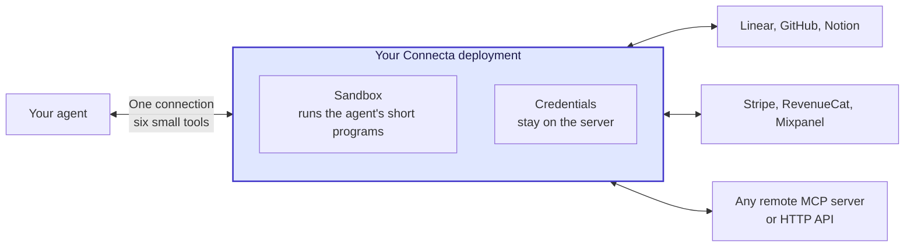
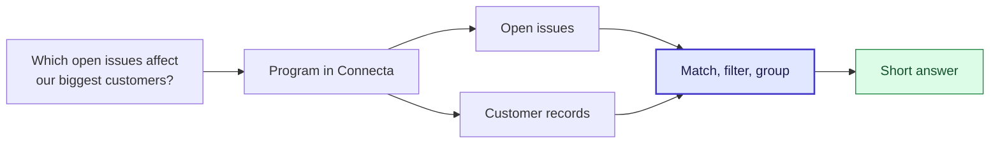
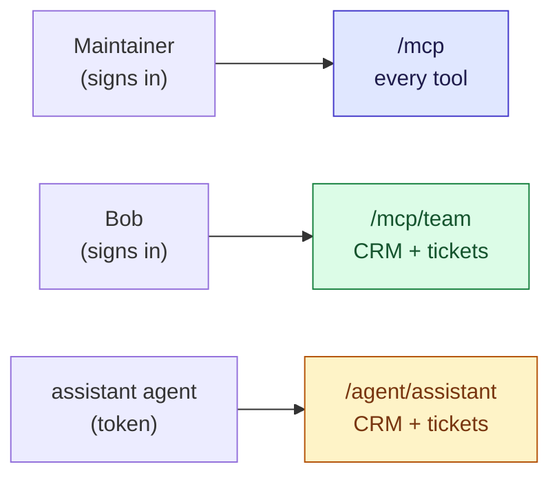
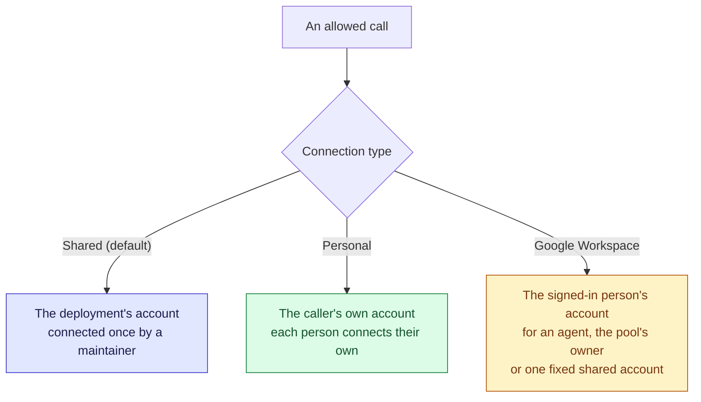
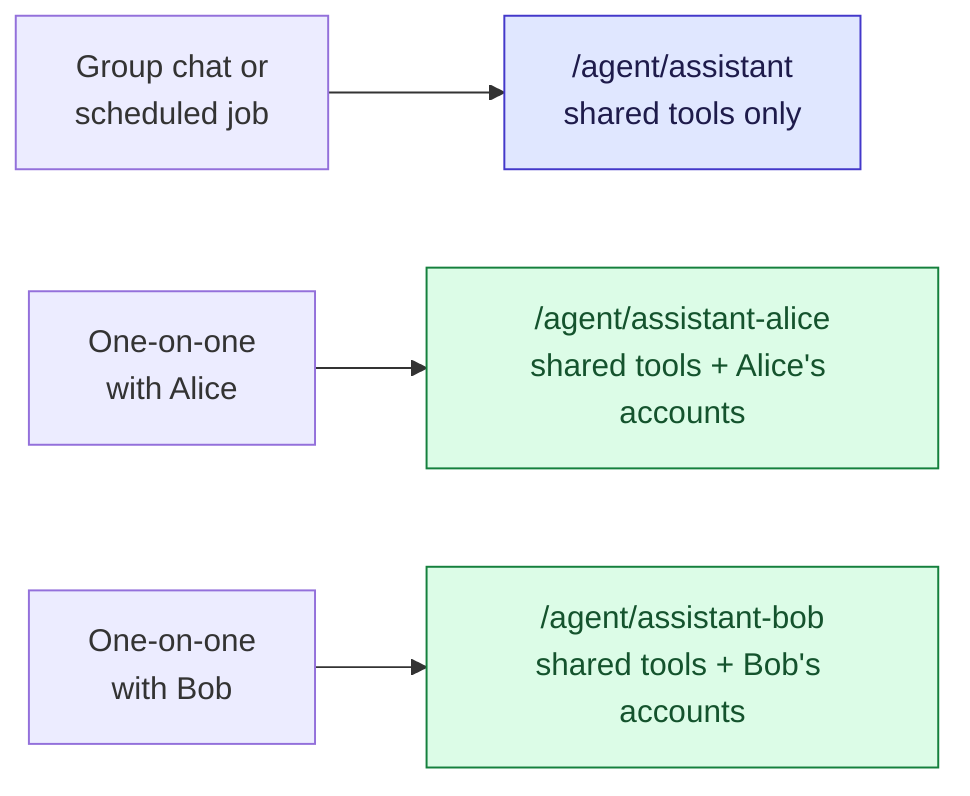
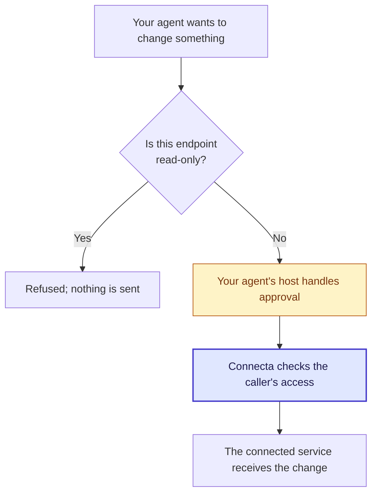

# connecta

**One connection between your agent and the services you choose.**

Connecta puts your MCP servers and HTTP APIs behind one endpoint that you run
yourself. Connect your agent once; decide in code who can reach what.

## How it works

The agent doesn't load every service's tools into the conversation. It writes
a short program that gathers, joins, and trims results inside Connecta, so
only the answer comes back.

## What you can connect

Maintained connections: <!-- providers:start -->Basecamp, Breeze ChMS, Church Community Builder, Cloudflare, GitHub, Gmail, Google Docs, Google Drive, Google Forms, Google Sheets, Google Slides, Infisical, Linear, Mixpanel, Notion, Overflow, Planning Center, RevenueCat, Stripe, Tithe.ly, Vercel, and Wispr Flow<!-- providers:end -->.
Plus any remote MCP server or HTTP API you describe.

| Connection                         | Notes                                                                                      |
| ---------------------------------- | ------------------------------------------------------------------------------------------ |
| Stripe, Notion, Cloudflare, Vercel | OAuth uses the vendor's hosted MCP server; an API key or token uses Connecta's own client. |
| Gmail                              | Reads mail and attachments, writes drafts. Never sends.                                    |
| Google Drive                       | Reads, writes, and shares files. Never permanently deletes.                                |
| Google Workspace (all)             | A Workspace admin authorizes it once for the domain.                                       |
| Your own MCP servers and HTTP APIs | Add them in deployment code.                                                               |

## Who can use it

Two kinds of caller, kept apart on purpose:

|                          | People                                               | Agents                                                  |
| ------------------------ | ---------------------------------------------------- | ------------------------------------------------------- |
| What they are            | You and your team                                    | Bots, assistants, CI, scheduled jobs                    |
| How they prove it        | Sign in: Clerk (Node) or Cloudflare Access (Workers) | One token Connecta issues to that agent                 |
| How they're added        | Named in deployment code                             | Named in deployment code; a maintainer issues the token |
| Their own service logins | Yes                                                  | No. An agent uses accounts you assign it                |
| Can manage Connecta      | Maintainers only                                     | Never                                                   |

People come in two roles:

- **Maintainers** run the deployment: they reach every tool, connect shared
  accounts, manage agent tokens, and read activity.
- **Pool members** reach only the pools they're listed in.

### Pools

A **pool** is a named set of tools plus a list of who may use it. Each pool
has its own address, and every caller sees exactly that pool's tools.

| Address         | Who gets in               | What they see     |
| --------------- | ------------------------- | ----------------- |
| `/mcp`          | Maintainers               | Everything        |
| `/mcp/<pool>`   | People listed in the pool | That pool's tools |
| `/agent/<pool>` | Agents listed in the pool | That pool's tools |

- Not a member? You get the same "not found" as a pool that doesn't exist.
- In two pools? You use two addresses. Pools never merge.
- Maintainers aren't in any pool automatically.
- Agent tokens are refused at people addresses, and sign-ins are ignored at
  agent addresses. Behind Cloudflare Access, an agent sends only its token.
- With no sign-in and no agent tokens configured, a deployment is open: anyone
  who can reach it gets everything, and Connecta warns at startup. The shipped
  templates always configure agent tokens, so they are never open.

### Whose account a connection uses

Reaching a tool and which downstream account it runs as are separate questions.

Agents have no account of their own, so personal connections never appear for
them. To let an agent use Alice's notes, add a shared connection for her
account (`notes_alice`) and list it only in her pool.

### One agent, many people

An assistant that talks to several people keeps **one token and one
connection**. Its harness, not the model, picks the pool each turn:

Never add another person to someone's personal pool: they would act as that
person.

### Who can do what

|                              | Maintainer                        | Pool member                    | Agent       |
| ---------------------------- | --------------------------------- | ------------------------------ | ----------- |
| Use tools                    | Everything, plus pools they're in | Their pools                    | Their pools |
| Connect shared accounts      | Yes                               | No                             | No          |
| Connect their own accounts   | Yes                               | Yes, in their pools            | No          |
| Issue or rotate agent tokens | Yes                               | No                             | No          |
| Read activity                | Yes                               | No                             | No          |
| Operator UI                  | Everything                        | Their addresses and own logins | No          |

## Reads and writes

Every endpoint is writable or read-only, and you choose explicitly.

On a read-only endpoint, search hides write tools and every write is refused.
Neither setting grants access to more services.

## Operator UI (optional)

A web page for seeing connections, tools, access, and configuration. Changes
to integrations and access rules still happen in deployment code.

| Maintainers see                                                                                             | Pool members see                         |
| ----------------------------------------------------------------------------------------------------------- | ---------------------------------------- |
| Every connection, its tools, and its status                                                                 | Their pool addresses and client setup    |
| Shared credentials and OAuth controls                                                                       | Their own logins on personal connections |
| Agent tokens: issue, rotate, revoke                                                                         |                                          |
| Optional activity: who called what, when, and whether it worked. Never arguments, results, or program code. |                                          |

## Where it runs

|                 | Node or Docker | Cloudflare Workers                |
| --------------- | -------------- | --------------------------------- |
| People sign in  | Clerk          | Cloudflare Access                 |
| Storage         | SQLite         | D1                                |
| Program sandbox | QuickJS        | Worker Loader (Workers Paid plan) |

Both serve the same agent tools.

## Getting started

Give your agent the [agent documentation](./documentation/README.md) and ask
it to set up Connecta with the integrations you want, where to run it, and who
should have access.

Upgrading? Point your agent at the
[upgrade guidance](./documentation/deploying.md#upgrade-an-existing-deployment).

## Status

Built for its author's deployments first and published openly. Breaking
changes are expected before 1.0. See the [changelog](./CHANGELOG.md) and
[security policy](./SECURITY.md).

[Principles](https://github.com/zackbart/connecta/blob/main/PRINCIPLES.md) ·
[Decision records](https://github.com/zackbart/connecta/tree/main/decisions) ·
[Planned work](https://github.com/zackbart/connecta/issues) (a plan is not a
shipped feature)
