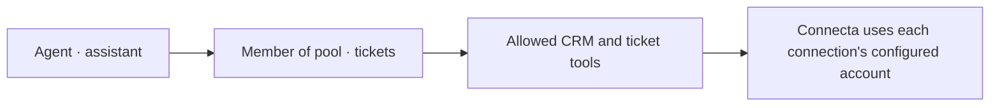
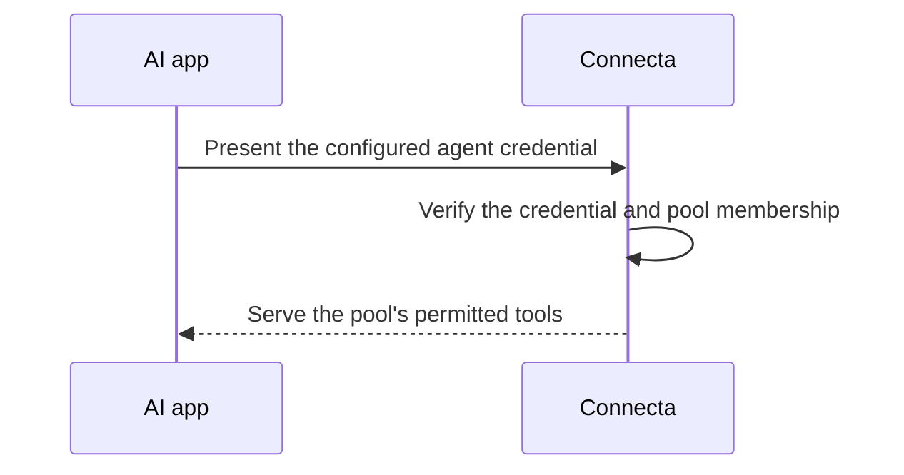

# Connecting an agent

Your **operator** is the person or team running the Connecta server. They
choose which agent can connect, which tools it can use, and which service
accounts those tools use. The model cannot grant itself more access.

This guide explains those choices. The [operator documentation](../documentation/README.md)
has exact setup and verification steps.

## Choose the pool first

Imagine an agent named `assistant` that helps with CRM records and tickets.
Its operator creates a pool with the actions needed for that job and adds
the agent as a member. Agent pools contain only agents; people use separate
pools that can share the same tool list. The pool can be read-only if updates must be impossible.



The address uses the **pool name**, not the agent name. If `assistant` belongs
to a pool called `tickets`, its address is `/agent/tickets` on your Connecta
server. For a pool called `assistant`, it is `/agent/assistant`.
Ask your operator for the complete URL, such as
`https://connecta.example.com/agent/tickets`; the model should not guess it.

For shared organization access, a maintainer connects the service accounts
once. The agent proves its identity to Connecta and never needs the CRM's
password or the ticket service's API key. The operator should enable the
[encrypted credential vault](../documentation/auth.md#connect-a-shared-credential)
before saving those credentials or connecting accounts.

## What to ask your operator for

- **The pool name and complete endpoint URL.** Confirm this agent is a member.
- **The authentication method.** Ask how the AI app will receive the agent
  credential privately; keep it out of prompts and source files.
- **The tools and accounts.** Know which actions are available, whose account
  they use, and whether changes are allowed. In 0.35.0, a pool can offer
  [native tools](../documentation/meta-tools.md#tool-presentation) for apps
  with their own tool search.
- **The approval policy.** Find out whether writes ask a person or run unattended.
- **A safe first test.** Agree on a small read, such as listing one ticket,
  and the result you expect.

People use separate sign-in endpoints. The
[pool reference](../documentation/auth.md#pools) owns the address and membership rules.

## Choose how the agent proves its identity

| Method                   | Best fit                    | What the operator provides                                     |
| ------------------------ | --------------------------- | -------------------------------------------------------------- |
| Connecta agent token     | An agent running anywhere   | A `cta_` secret issued for the declared agent.                 |
| Vercel workload identity | An agent deployed on Vercel | Permission for a trusted project and its allowed environments. |

An agent token stays in the AI app's secret store. The app presents it when
it connects. Vercel identity uses a signed project token instead of a
separately provisioned Connecta secret.



[Safety and trust](./safety-and-trust.md#a-credential-proves-an-agent-not-a-person)
explains who can act with these credentials. The
[token management guide](../documentation/auth.md#issue-rotate-or-revoke-an-agent-token)
and [Vercel identity guide](../documentation/auth.md#vercel-workload-credentials)
own setup, rotation, and revocation.

## An optional integration for Eve

**Eve** is an app framework for building agents. If your agent uses Eve,
`@zackbart/connecta-eve` can connect it to a pool and load the endpoint's
instructions at the start of a turn. The helper runs in the Eve app; your
Connecta server runs separately.

The [helper's README](https://github.com/zackbart/connecta/blob/main/packages/connecta-eve/README.md)
owns installation, supported Node/Eve versions, environment setup, and the
Vercel variant. The following two files illustrate its two jobs after your
operator has configured the endpoint and credential.

`agent/connections/connecta.ts` connects to the pool:

```ts
import { connectaConnection } from "@zackbart/connecta-eve";

export default connectaConnection({
  pool: "tickets",
  description: "Shared CRM and tickets for the assistant.",
});
```

`agent/instructions/connecta.ts` supplies guidance for using it:

```ts
import { connectaInstructions } from "@zackbart/connecta-eve";

export default connectaInstructions({ pool: "tickets" });
```

Both files must use the same endpoint and credential source. The helper uses
the configured agent credential, without forwarding the chatting person's
identity. Instructions help the model use tools; they grant no permissions.

## Decide whether writes need a person

Agree on an approval policy before enabling writes. See
[approval boundaries](./safety-and-trust.md#read-only-blocks-actions-that-change-data)
and the [Eve helper's approval setup](https://github.com/zackbart/connecta/blob/main/packages/connecta-eve/README.md#approval-and-writes).

## When accounts or audiences differ

Personal connections belong to a signed-in person and are absent for agents.
Google Workspace has an explicit exception: an operator can assign a pool
owner whose account the agent will use. See
[Workspace pool owners](../documentation/auth.md#pool-owners-for-google-workspace)
before connecting an agent to someone's account.

A connection to the organization's own service can instead act as whoever
signed in, by forwarding that person's identity. Agents cannot use such a
connection unless the operator also allows them, and then they appear to the
service as themselves, never as a person. See
[forwarding the admitted principal](../documentation/auth.md#forwarding-the-admitted-principal).

An assistant serving several people must use a pool appropriate for everyone
in the conversation. Its app chooses that pool; the model does not choose
its own access level. Keep private results out of broader conversations.
The [pool layout guide](../documentation/auth.md#organizing-an-agents-pools)
owns that policy.

After setup, run the agreed small read with your operator. Use the
[verification guide](../documentation/deploying.md#verify-and-diagnose)
when the connection or access differs from what you expected.
