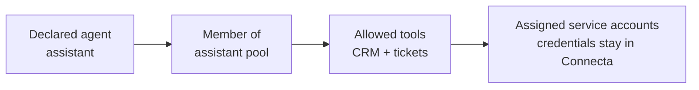
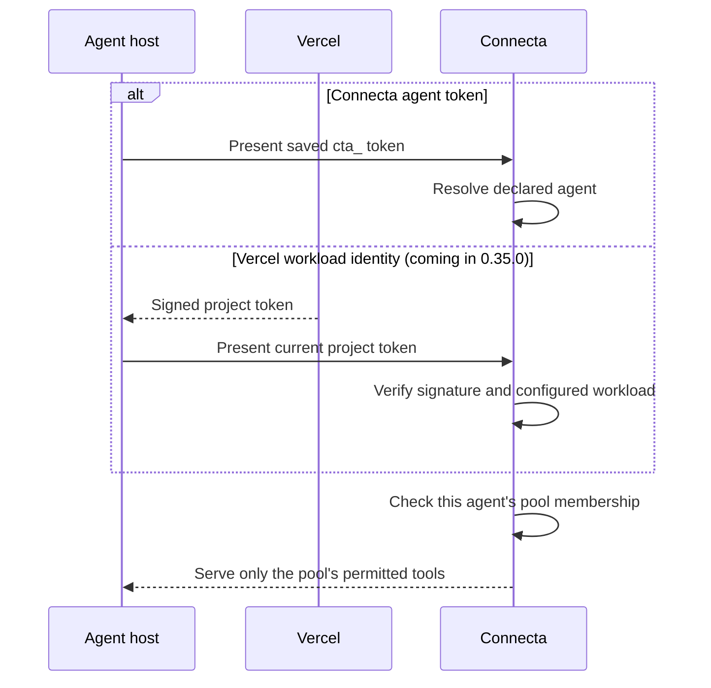
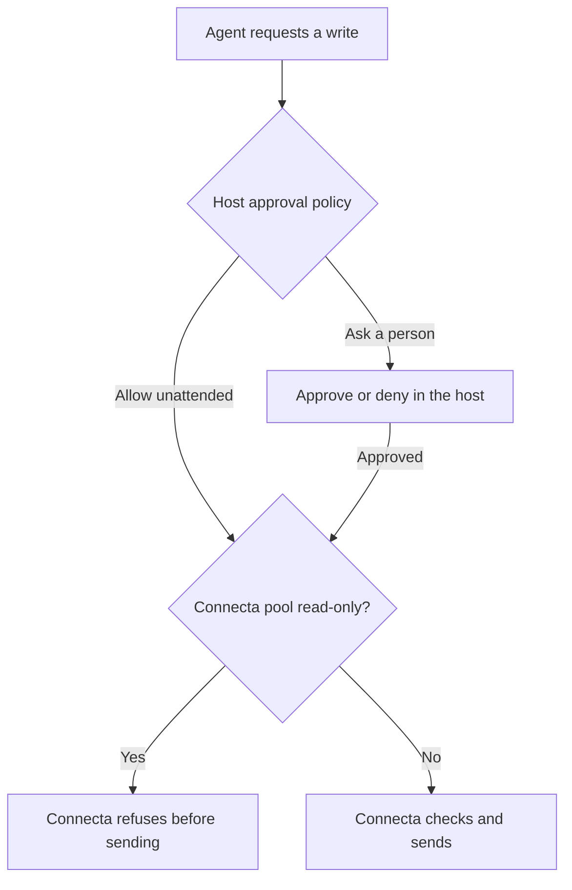

# Connecting an agent

Giving an agent organization access means answering three questions:
which agent is calling, which tools may it use, and whose service accounts
will those tools use?

Connecta keeps those choices in deployment code. The model cannot grant
itself more tools by asking for them.

This guide explains the choices. Use the [operator task index](../documentation/README.md)
for exact setup and verification steps.

## Choose the pool first

Imagine an agent named `assistant` that helps with CRM records and tickets.
Give it a pool containing just the tools needed for that job. Its connection
address is `/agent/assistant` when the pool is also named `assistant`.
The agent and pool are separate names; they need not match.



A pool can include every tool from a connector or only selected tools.
Make the pool read-only if updates must be impossible. Also consider a
read-only account or restricted credential at the service itself.

For organization access, a maintainer connects the shared service accounts
once. The agent proves its own identity to Connecta; it does not need the
CRM's password or the ticket service's API key.

Agents do not inherit a chatting person's login. Personal-auth connectors
are absent for agents. Google Workspace offers a separate pool-owner model
when an agent should act as an explicitly assigned person.

Use [pool setup](../documentation/auth.md#pools),
[shared credentials](../documentation/auth.md#connect-a-shared-credential),
and [Workspace pool owners](../documentation/auth.md#pool-owners-for-google-workspace)
for those details.

## Choose how the agent proves its identity

| Method                   | Best fit                    | What you manage                                                     |
| ------------------------ | --------------------------- | ------------------------------------------------------------------- |
| Connecta agent token     | An agent running anywhere   | One `cta_` secret per declared agent, with rotation and revocation. |
| Vercel workload identity | An agent deployed on Vercel | A binding to its team, project, and allowed environments.           |

**Coming in 0.35.0:** Vercel workload identity is merged on main and awaits
publication. Agent tokens remain available for agents on any platform.



An agent token is issued through trusted provisioning or the maintainer UI.
Save it in the agent host's secret store. Rotation replaces the old token;
revocation stops future requests using it. A request already admitted is
not recalled.

Vercel identity removes the separately provisioned Connecta secret. Connecta
checks the signed token against the team, project, and environments declared
for the agent. Production is the default; enabling preview or development
extends that same access to those workloads.

The Vercel token is still a bearer credential. Anything that obtains it can
act as the agent, including trusted project code and build steps. Bind only
projects and environments you trust with the pool's access.

Both methods can coexist for one agent. Revoking its `cta_` token leaves
Vercel admission active; removing the workload binding leaves the agent
token active. Removing the declared agent stops both paths.

The operator procedures are [agent token management](../documentation/auth.md#issue-rotate-or-revoke-an-agent-token)
and [Vercel workload credentials](../documentation/auth.md#vercel-workload-credentials).
People use the separate human endpoints and sign-in flow.

## The Eve helper in two files

**Coming in 0.35.0:** `@zackbart/connecta-eve` is a separate helper package,
merged on main and awaiting publication. It runs inside the Eve app; your
Connecta server runs separately. It requires Node 24+ and currently supports
Eve `>=0.83.0 <0.84.0`. Use matching helper and server release versions.

The helper has two jobs: connect Eve to the agent's pool, and give the model
that endpoint's instructions at the start of a turn.

After your setup agent configures the pool and supplies `CONNECTA_URL` and
`CONNECTA_ACCESS_TOKEN` in the Eve app's environment, the token-based example
uses these two files.

`agent/connections/connecta.ts`:

```ts
import { connectaConnection } from "@zackbart/connecta-eve";

export default connectaConnection({
  pool: "assistant",
  description: "Shared CRM and tickets for the assistant.",
});
```

`agent/instructions/connecta.ts`:

```ts
import { connectaInstructions } from "@zackbart/connecta-eve";

export default connectaInstructions({ pool: "assistant" });
```

The connection uses app-owned credentials. It does not forward the person
chatting with Eve. Both files must use the same endpoint and token source.
With Vercel identity, both can use `getVercelOidcToken` through `getToken` to
resolve a current credential for each request.

Instructions help the model use the tools; they grant no access. A failed
instruction refresh may leave older guidance or no guidance while tools
remain usable.

The [helper package guide](https://github.com/zackbart/connecta/blob/main/packages/connecta-eve/README.md)
owns installation, environment setup, and the complete Vercel variant.

## Decide whether writes need a person

The helper defaults to Eve's `never()` approval policy: authorized writes
run unattended. Connecting an agent does not add a human approval step.



For an interactive agent, the helper's `gateWrites: true` asks before tools
not marked read-only, including code on a writable pool. An explicit Eve
approval policy takes precedence. For an agent that must never update data,
choose a read-only pool.

The gate reads the host's cached tool labels. If a tool changes from read to
write before dispatch, Connecta uses its current classification. A writable
pool can then write without a fresh approval; a read-only pool refuses it.
See [Safety and trust](./safety-and-trust.md) before choosing that boundary.

Native tools for Eve's own search are planned for 0.35.0 and pending in
[#977](https://github.com/zackbart/connecta/pull/977). The helper also works
with the current six-tool surface; native tools are a separate pool choice.

## When one assistant serves several people

One agent identity can belong to several pools. The harness chooses the pool
for each conversation, based on everyone present. A group must not inherit
one participant's private access, and the model must not choose its own tier.

Begin with shared organization access. Add personal pools only when the
harness can reliably select them and keep conversation state separated.
The [agent pool layout](../documentation/auth.md#organizing-an-agents-pools)
explains tier selection and personal-account boundaries.

After setup, your operator should verify the intended endpoint, confirm its
visible tools, try a bounded read, and check that an excluded pool refuses
access. The [deployment verification guide](../documentation/deploying.md#verify-and-diagnose)
provides the concrete checks.
