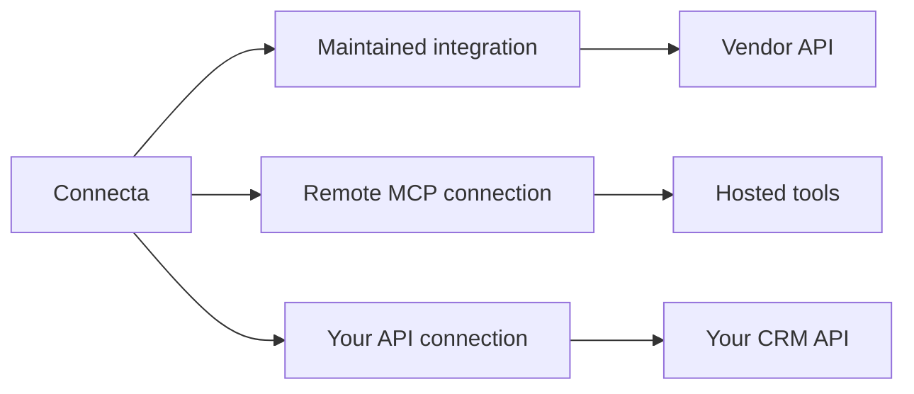
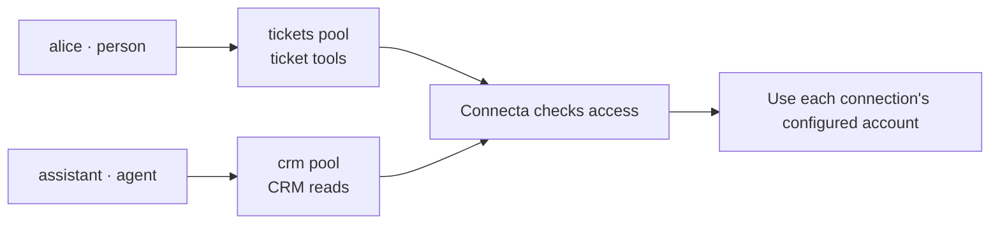
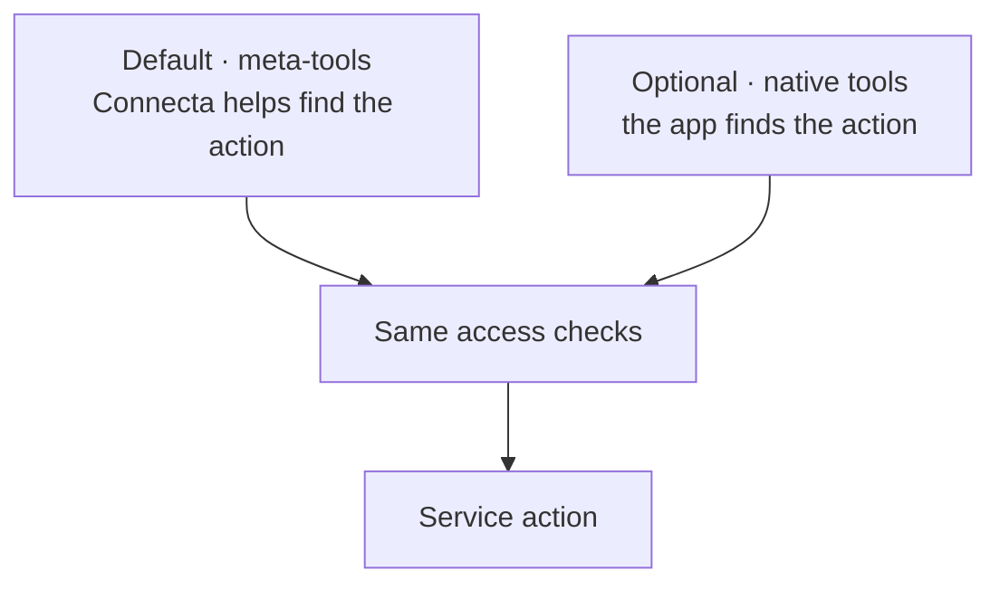
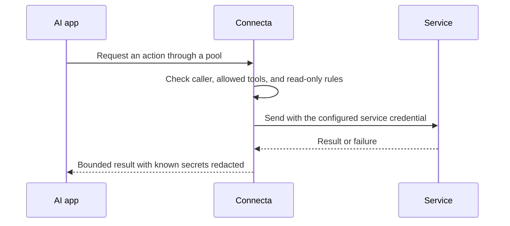

# How Connecta works

Connecta is a front door for the services your agent needs. It gives the
agent one connection, then checks each request before it reaches a service.
Your **operator**, the person or team running Connecta, chooses what belongs
behind that door.

This guide explains the pieces. The [operator documentation](../documentation/README.md)
owns exact setup and behavior.

## Start with connections

A **connector** is one connection to a service. For example, a connector
called `crm` could reach your shared CRM account, where you keep customer
records. Its tools might find a person or update their address.
A second connector could reach a different account at the same service.

An **API** is the interface a service gives other software. Connecta can wrap
that interface in tools, or connect to a hosted MCP server that already offers
tools. MCP is the standard used to make those tools available to AI apps.

A maintained integration comes with Connecta's tools and guidance. A remote
MCP connection uses the tools the server offers to that account. A custom
API connection lets your operator describe selected actions.

All three go through Connecta's access checks. A remote server's list of
actions can change, and Connecta relies on truthful descriptions of which
actions change data.

The README lists [maintained connections](../README.md#what-you-can-connect).
For setup and migrations, see [Integrating services](../documentation/integrating.md).

## A pool is a smaller front door

A **pool** is a named selection of tools and the people or agents allowed
to use them. The operator creates it and gives it an **endpoint**: a
connection address for that pool.

One pool might let the assistant read CRM records. Another might let a
person update tickets. Tools and accounts are separate choices: a pool
chooses the actions, while each connection uses its configured account.

People sign in. Agents use an identity configured by the operator.
The model cannot change that identity or add itself to a pool.

Each request uses one pool. Belonging to two pools does not merge them.
An AI app can switch between pools it is allowed to use; its software must
choose the right one for the conversation. The model does not choose its
own access level.

Maintainers run the deployment and can reach its whole tool list through
the main human endpoint. Other people use their assigned pools.
Agents use shared accounts selected by the operator. They do not inherit
the account of the person chatting with them.

[Connecting agents](./connecting-agents.md) explains pool addresses and
account choices, including the Google Workspace exception.

## Finding a tool and using it are separate steps

First the agent finds an action and learns what information it needs.
Then it calls that action. The default connection gives the AI app six small
**meta-tools** to help it do this without loading every service's tools into
the conversation.

| Tool                    | Job                                                                          |
| ----------------------- | ---------------------------------------------------------------------------- |
| `search_tools`          | Find available actions.                                                      |
| `call_tool`             | Call a discovered action that reads data.                                    |
| `call_destructive_tool` | Call a discovered action that changes data, under the app's approval policy. |
| `execute_code`          | Combine discovery, actions, and a small answer in a program.                 |
| `authorize_connector`   | Request the permitted account-connection handoff.                            |
| `skills`                | Read guidance for using a connection.                                        |

In 0.35.0, **native tools** let apps with their own tool search find service
actions directly. The operator chooses the pool's presentation.

The presentation changes how an action is found, without granting more
access. The [tool reference](../documentation/meta-tools.md#tool-presentation)
tracks availability and supported behavior.

## Why run code inside Connecta?

Suppose the agent needs a count of open tickets for each CRM account.
Instead of returning every record to the conversation, a short JavaScript
program can fetch the records, match their IDs, and return a small table.

The program runs in a restricted environment. It can use only this endpoint's
tools, and cannot create connections, choose another identity, or obtain
service credentials. Limits keep it from running indefinitely or returning
unbounded data.

With meta-tools, one discovered read can use a direct call. Finding an unfamiliar
action, combining several calls, or reducing a large answer belongs in a program.
On a writable endpoint, a program may also change data; see
[approval boundaries](./safety-and-trust.md#read-only-blocks-actions-that-change-data).

The [endpoint workflow](../documentation/operating.md) and
[code reference](../documentation/code-mode.md) explain the mechanics.

## Follow one call

These checks also apply to calls inside programs. Guessing a tool name does
not bypass them. Read-only rules refuse tools marked as writes before they
are sent.

For tools marked as writes, Connecta does not automatically repeat a sent
change after an uncertain failure. Truthful tool classification matters;
[Safety and trust](./safety-and-trust.md) explains the limit and recovery.

## Why an answer may be shorter

Programs can filter, count, join, and summarize records before returning
them. Connecta also limits output size. Some large results return a preview
and a handle for retrieving more; some tools shorten fields and report it.
A preview is not necessarily the whole answer.

The [result reference](../documentation/meta-tools.md#result-representation)
explains how to retrieve more. Never repeat a change just to recover its
output. Redaction keeps known secrets out of results; it does not make
business records safe to share with everyone.
