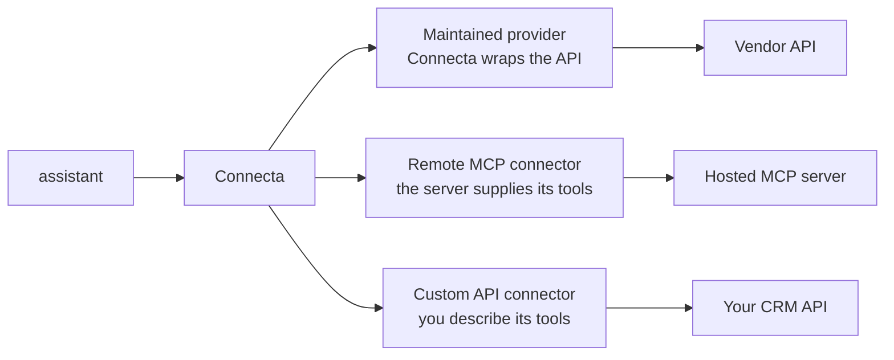
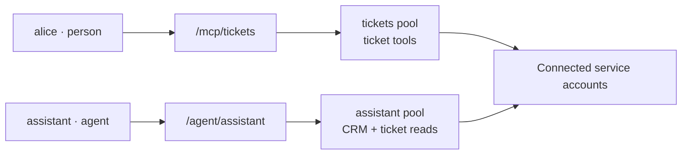
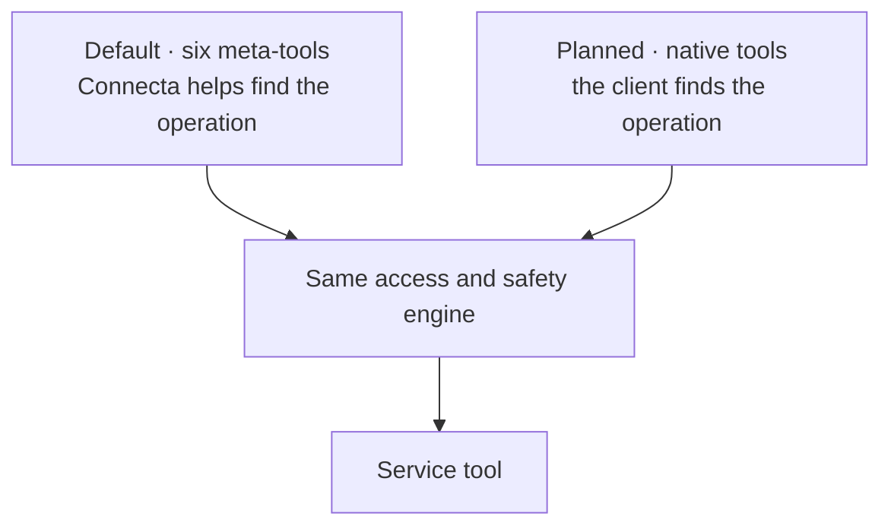
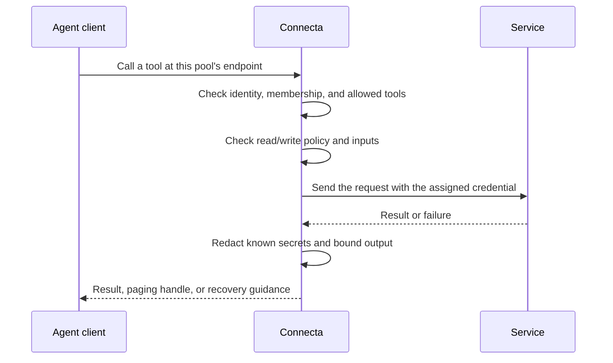

# How Connecta works

Connecta is a front door for the services your agent needs. It gives the
agent one connection, then checks each request before it reaches a service.
You run the deployment and decide what belongs behind that door.

This guide explains the pieces. The [operator documentation](../documentation/README.md)
owns exact setup and behavior.

## Start with connections

A **connector** is one connection to one service account or API. You might
have a connector called `crm` and another called `tickets`.
Two connectors can reach different accounts at the same service.

Each connector offers **tools**: actions such as finding a person, listing
tickets, or updating a record. Tools have names, descriptions, and expected
inputs so the agent can discover how to use them.

A maintained provider comes with Connecta's tools and domain guidance.
A generic remote MCP connection discovers whatever tools the server makes
available to that account. A custom API connector lets you describe selected
operations yourself.

These choices all go through the same access and safety checks. A remote
server's catalog may change; choosing it also means trusting that server's
behavior and read/write labels.

The README lists [maintained connections](../README.md#what-you-can-connect).
For setup, see [Integrating services](../documentation/integrating.md).

For upgrades, 0.35.0 removes the Infisical, Notion, and Mixpanel provider
factories. Notion and Mixpanel's hosted MCP servers use generic `remoteMcp()`
connections; Infisical has no built-in replacement.
The [0.35 provider migration guide](../documentation/provider-migration-0.35.md)
owns the replacement steps.

## A pool is a smaller front door

A **pool** is a named selection of tools and the people or agents allowed
to use them. It has its own endpoint, or connection address.
One pool might offer only CRM reads; another might also allow ticket updates.

People sign in through the deployment's human authentication provider.
Agents prove a declared machine identity. Their pool membership comes from
deployment code, never from a prompt or tool argument.

Each request uses one pool. Belonging to two pools does not merge them.
Maintainers run the deployment and can reach its whole catalog through the
main human endpoint; ordinary members use their assigned pools.

A pool chooses which tools are available. Credentials decide whose service
account those tools use. Shared credentials belong to the deployment;
personal connections belong to a signed-in person and are absent for agents.
Google Workspace also supports an explicitly assigned pool owner for agent
access to that person's account.

An agent does not become the person chatting with it. Its harness must choose
an appropriate pool when different people share an assistant. Start with
[Connecting agents](./connecting-agents.md), then use the
[pool layout guide](../documentation/auth.md#organizing-an-agents-pools).

## Two ways to present the tools

The default connection gives the client six small **meta-tools**. They let
the agent find and call the underlying service tools without loading every
service's entire catalog into its conversation.

| Tool                    | Plain-language job                                               |
| ----------------------- | ---------------------------------------------------------------- |
| `search_tools`          | Inspect the available tools.                                     |
| `call_tool`             | Run one known read.                                              |
| `call_destructive_tool` | Run one known write through the host's approval policy.          |
| `execute_code`          | Run a short program with discovery, calls, and result reduction. |
| `authorize_connector`   | Request the permitted credential or sign-in handoff.             |
| `skills`                | Read connector guidance.                                         |

**Coming in 0.35.0, pending [#977](https://github.com/zackbart/connecta/pull/977):**
a native tool surface for clients that already search their own tool catalog.
A native pool presents its service tools directly, so the client can find
the real operation in its own search. Code remains available by default.

This changes how the client finds a tool. It does not grant more access or
choose a different service account. The native proposal targets bounded
pools; large catalogs still need separate evaluation.

The [meta-tool reference](../documentation/meta-tools.md#the-six-tools)
describes the current default surface.

## Why run code inside Connecta?

Suppose the agent needs a count of open tickets for each CRM account.
It could bring every record into the conversation, then ask the model to
join them. Instead, `execute_code` can fetch the records, match their IDs,
and return a short table.

The agent writes JavaScript in a sandbox. It can use the tools allowed by
its endpoint, with the same checks as individual calls. The program cannot
create connectors, select another identity, or obtain service credentials.
It has limits on time, calls, writes, and output.

For read work, a single known operation uses a direct call. Discovery,
several dependent calls, or reducing a large result belongs in a program.
On a writable endpoint, a program may also write; the host decides whether
to approve that program.

See [Operating an endpoint](../documentation/operating.md) for the workflow
and [Code mode](../documentation/code-mode.md) for the JavaScript contract.

## Follow one call

Those checks also happen for calls made inside a program. A tool name the
model guesses cannot bypass them. A read-only endpoint refuses a write
before dispatch, even when a program asks for it.

If a dispatched write fails ambiguously, Connecta reports an unknown outcome
and does not automatically send it again. The agent must check the service's
state before deciding what to do next.

## Why the answer may be shorter than the service response

Large responses can overwhelm a conversation. Programs can filter, count,
join, and summarize data before returning it. Connecta also bounds output;
oversized supported results can be stored temporarily and returned through
a paging handle. Some provider tools trim individual fields and report it.

A preview is not necessarily the whole answer. Follow the paging guidance
or retrieve the missing records. Never repeat a write just to recover its
output; read its stored result or check the service instead.

Redaction has a different purpose: keeping known secrets out of agent output.
It does not make business records public or remove every piece of personal
data. Pools and downstream account permissions still determine who should
receive those records.

Read [Safety and trust](./safety-and-trust.md) for these limits, or the
[result reference](../documentation/meta-tools.md#result-representation)
for exact paging and truncation behavior.
