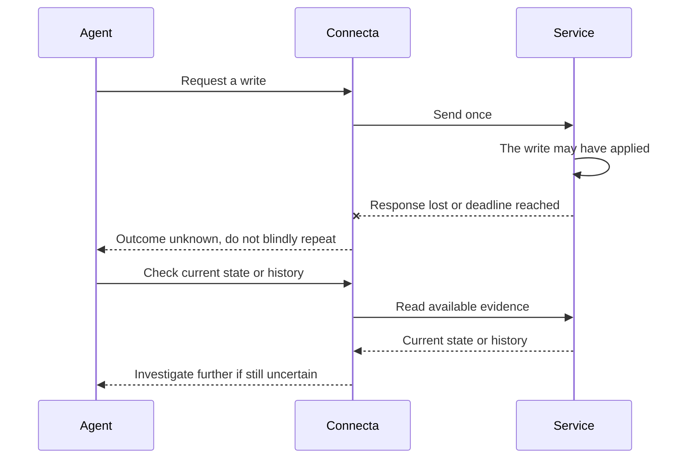
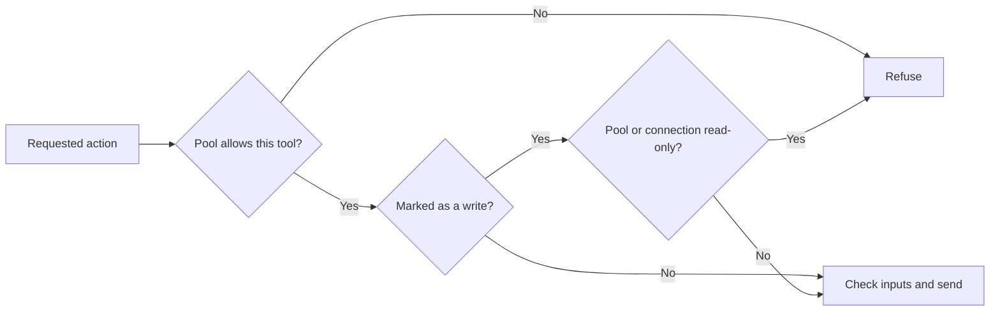
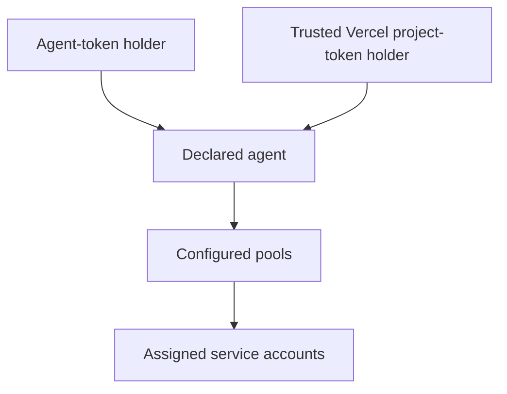

# Safety and trust

Connecta helps limit tool access. It does not approve every action or
guarantee that returned business data is safe to share. Your operator—the
person or team running the server—chooses accounts, access, and approval rules.

With authentication configured, Connecta checks who is calling and which
tools they can use. Without configured authentication, the main `/mcp`
endpoint serves its whole tool list to anyone who can reach it.

The [operator documentation](../documentation/README.md) owns exact setup
and behavior. This guide explains the boundaries and their limits.

## A timeout can leave a change's status unknown

A **write** changes something: a record, payment, permission, or other service
state. The service might apply it even when no answer comes back. Check the
current record or service history before trying again.

For tools classified as writes, once Connecta sends a change, it never
automatically sends it again. This includes a timeout or a lost response.
That does not promise the service completed it exactly once. A new request
or a rerun of a program can repeat the action.

An **unknown outcome** means Connecta cannot prove whether the change
happened. A read may help, but may not settle it. If the answer is still
unclear, stop and investigate.

Do not repeat a successful change just to recover its output either.
The [write contract](../documentation/code-mode.md#writes) and
[result recovery guide](../documentation/meta-tools.md#paging-with-connectaresult)
explain how to check the service or retrieve retained output.

## Read-only blocks actions that change data

A read-only pool hides tools marked as writes and refuses attempts to call
them before sending anything. Guessing a tool name or asking from a program
does not bypass it. A whole service connection can also be read-only; a
writable pool cannot reopen that connection for writes.

Read-only protection and the single-attempt rule depend on truthful
classification: the labels identifying actions that change data. Missing
or contradictory read hints count as writes, but a service can mislabel an
action and an operator can override its label. Use restricted service
credentials as another boundary where possible.

The AI app owns approvals. It may ask based on an earlier tool label. If a
read becomes a write, a writable pool can execute it without a fresh
approval; a read-only pool refuses it. Connecta does not pause a program to
ask a person partway through.

See [read-only setup](../documentation/integrating.md#make-one-connection-read-only)
and the [write policy](../documentation/code-mode.md#writes) for exact rules.

## Keep credentials private and enable the vault

The agent receives tool results without needing the service credential used
to make the call. Redaction removes known secrets from output, but is not a
general detector for every secret or piece of personal data in a record.

With the encrypted credential vault configured, Connecta seals stored
downstream credentials and OAuth tokens and binds each to its connector and
owner. Without a vault, stored OAuth tokens are kept in plaintext, so enable
the vault **before connecting accounts**. Follow
[shared credential setup](../documentation/auth.md#connect-a-shared-credential)
and [OAuth storage rules](../documentation/auth.md#downstream-oauth-state-at-rest).

Maintained integrations also withhold reviewed sensitive values. A value
shown as `[redacted]` is unavailable, not a usable credential. Redaction
covers known values and supported forms; a malicious service can transform
data into forms outside that coverage.

Connecta's activity, status, and logs omit arguments, results, program source,
and raw downstream error text. Your AI app, proxies, and other logging systems
need their own data-handling policies. Keep agent tokens in the app's secret
store, outside prompts, source files, and logs.

The [operator data contract](../documentation/operator-ui.md#operator-data-contract)
explains activity disclosure.

## A credential proves an agent, not a person

Anyone holding an agent's `cta_` token can act as that agent. Vercel workload
identity uses a signed project token instead. It removes the separately
provisioned Connecta secret, while still trusting whoever can obtain the
project token.

Trust project code, build steps, and services receiving a Vercel token with
the same agent access. Preview or development environments should be enabled
only if they deserve that access too. A token holder may obtain fresh tokens,
so access can outlast the original token's expiry.

When both methods are enabled, stopping one leaves the other active.
Removing the declared agent stops both. Revocation does not recall requests
already admitted. Neither method identifies the human chatting with the agent.

The [token guide](../documentation/auth.md#issue-rotate-or-revoke-an-agent-token)
and [Vercel trust guide](../documentation/auth.md#vercel-workload-credentials)
own availability, project/environment choices, and revocation details.

## What the operator remains responsible for

| Decision                       | Why it matters                                                                                       |
| ------------------------------ | ---------------------------------------------------------------------------------------------------- |
| Inbound authentication         | Without configured `auth`, plain `/mcp` serves the whole catalog to anyone who can reach it.         |
| Enable the credential vault    | Encrypt stored credentials and OAuth tokens before connecting accounts.                              |
| Pool membership and tools      | Each member can use every action that pool grants.                                                   |
| Service permissions            | A shared credential uses the same account for every member.                                          |
| Forwarded identity             | A service that trusts a forwarded person must accept it only from this deployment.                   |
| Approval policy                | A writable pool can run unattended; the Eve helper defaults to that behavior.                        |
| Tool classification            | Labels must match the service's actual behavior.                                                     |
| Deployment and secret handling | Enable the credential vault; protect storage, encryption keys, backups, ingress, and the agent host. |
| Conversation routing           | Keep private results out of broader chats.                                                           |
| Uncertain changes              | Check the service before requesting another change.                                                  |

For concrete steps, use [deployment operations](../documentation/deploying.md),
[agent pool layout](../documentation/auth.md#organizing-an-agents-pools), and
[Connecting agents](./connecting-agents.md). The [security policy](../SECURITY.md)
explains how to report a problem.
