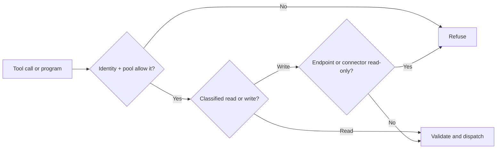
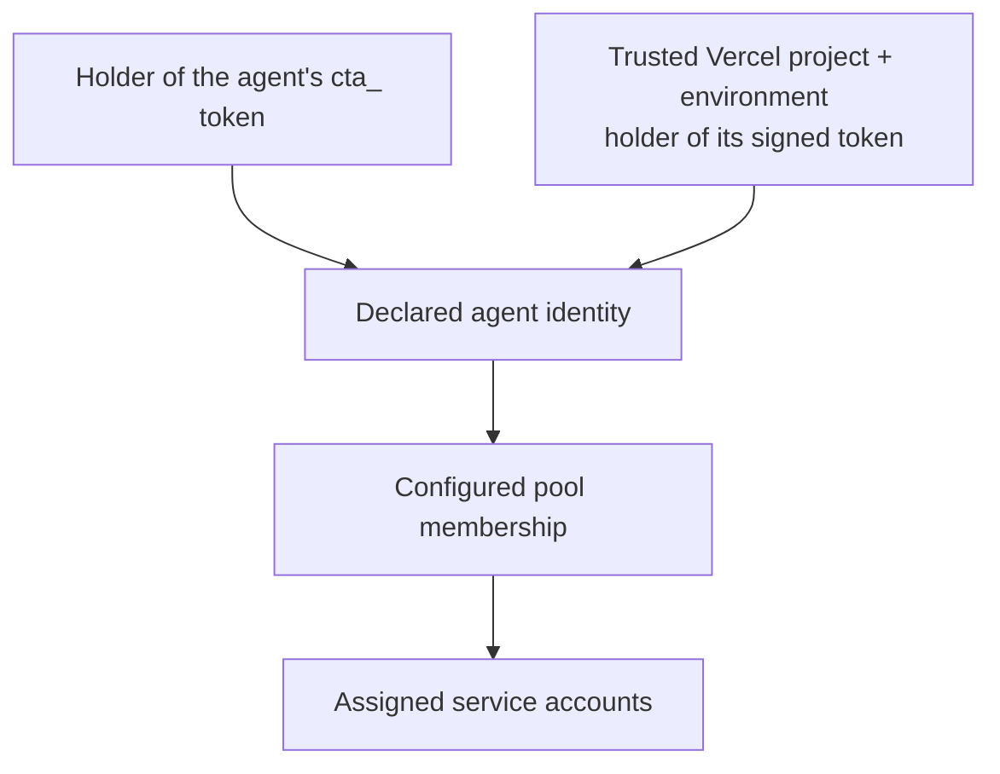

# Safety and trust

Connecta checks who is calling, which tools they can reach, and whether an
operation may write. It keeps service credentials on the server and bounds
what comes back to the agent.

Those boundaries help contain mistakes. You still choose the accounts,
services, host policies, and deployment that deserve your trust.

This guide explains the guarantees and their limits. The
[operator documentation](../documentation/README.md) owns exact behavior.

## A write gets one attempt

A write changes something: a record, payment, permission, or other service
state. Once Connecta dispatches a write, it never automatically replays it.
This includes an ambiguous timeout or a lost response.

That is a single-attempt guarantee. It is not a promise that the service
completed the operation exactly once, or that a fresh request cannot repeat
it. The service might have applied a write even though no answer came back.

```mermaid
sequenceDiagram
    participant A as Agent
    participant C as Connecta
    participant S as Service
    A->>C: Request a write
    C->>S: Send once
    S->>S: The write may have applied
    S--xC: Response lost or deadline reached
    C-->>A: Outcome unknown; do not blindly repeat
    A->>C: Read the target's current state
    C->>S: Check what actually happened
    S-->>C: Current state
    C-->>A: Evidence for the next decision
```

An **unknown outcome** means Connecta cannot prove whether the change
happened. Check the target record, transaction, or service history first.
If the result is still unclear, stop and investigate rather than assuming
the failed response means the write failed.

An idempotency key can help a service recognize duplicate intent, but it
does not turn a served Connecta write into an automatically retryable call.
A new model call or a rerun of a program is a new request. Connecta cannot
deduplicate arbitrary business intent across those requests.

Similarly, do not repeat a successful write just to recover a large result.
Page the retained output when available, or read the service's state.
The [write contract](../documentation/code-mode.md#writes) and
[result paging reference](../documentation/meta-tools.md#paging-with-connectaresult)
describe recovery.

## Read-only is an enforced boundary

A read-only endpoint hides tools classified as writes and refuses every
write call before validation or dispatch. Guessing a tool name or calling
it from JavaScript does not bypass the restriction.

A connector can also be read-only everywhere. A writable endpoint cannot
reopen a connector that is read-only.



The host decides approvals before sending permitted calls. Connecta does
not pause a program for approval. On a writable endpoint, `execute_code`
is marked as a write because the program may contain writes.

Read-only protection depends on truthful classification. For remote MCP
tools, missing or contradictory read hints count as writes. Deployment
overrides can change a label, so operators must review any override that
declares a tool safe to read. A downstream service could also mislabel a tool.
Use restricted service credentials as a second boundary where possible.

Host approval may use a cached label. If a listed read becomes a write,
Connecta enforces the current verdict: a writable pool may send it without
a fresh approval. A read-only pool refuses that write.

Use [connector read-only setup](../documentation/integrating.md#make-one-connection-read-only)
and [endpoint write policy](../documentation/code-mode.md#writes) for details.

## Secrets stay inside the service boundary

Connecta stores downstream credentials encrypted and keeps them separate by
connector and owner. Agent programs receive tool results, not the credential
used to make the call.

Known sent secrets are redacted from agent output. Maintained providers also
withhold reviewed sensitive values from their APIs. When a value appears as
`[redacted]`, treat it as unavailable; it is not a usable credential.

Connecta's activity, status, and log records omit arguments, results, program
source, and raw downstream error text. They record operational facts rather
than copies of the conversation's data.

Redaction has limits. It is not a general detector for every secret or piece
of personal data in business records. It covers known values and supported
representations; a malicious downstream can deliberately transform data into
forms outside that coverage. Service credentials already sent to a service
are necessarily known to that service.

The agent's own connection token is another secret. Keep it in the host's
secret store, outside model prompts, repository files, and logs. Your host,
proxies, and external logging systems need their own data-handling policies.

The [auth guide](../documentation/auth.md) owns credential handling;
the [operator data contract](../documentation/operator-ui.md#operator-data-contract)
describes activity disclosure.

## A credential proves an agent, not a person

A `cta_` token admits the declared agent to its configured pools. Anyone
holding it can act as that agent. Rotation or revocation stops future token
admission; already admitted requests are not recalled.

**Coming in 0.35.0:** Vercel workload identity admits a configured project
and environment as that same declared agent. It removes the separately
provisioned Connecta secret, while still using a bearer token.



Trust every part of the Vercel project that can obtain its tokens: runtime
code, builds, dependency install scripts, and services receiving the token.
Token holders may also obtain fresh tokens through Vercel's exchange, so
access can outlast the original token's expiry. The default audience is
shared across services that accept those project tokens.

Enabling preview trusts code on preview branches with the pool's access.
Enabling development extends access to holders of project development
tokens. Neither is enabled by default.

The two credential paths are independent. Revoke the Connecta token and
remove the Vercel binding if you need to stop both; removing the declared
agent stops both. Neither credential identifies the human talking to the
assistant or supplies per-user authorization.

See [agent token management](../documentation/auth.md#issue-rotate-or-revoke-an-agent-token)
and [Vercel workload trust](../documentation/auth.md#vercel-workload-credentials).

## What the operator remains responsible for

| Decision                                | Why it matters                                                                |
| --------------------------------------- | ----------------------------------------------------------------------------- |
| Pool membership and tool selection      | An admitted caller can use every tool that pool grants.                       |
| Service accounts and vendor permissions | A shared credential acts for the same account for every pool member.          |
| Host approval policy                    | A writable pool can run unattended; the Eve helper defaults to that behavior. |
| Connectors, labels, and overrides       | Classification must match the downstream tool's actual behavior.              |
| Deployment and secret handling          | Protect storage, encryption keys, backups, ingress, and the agent host.       |
| Conversation routing                    | Choose the right pool and avoid carrying private results into a broader chat. |
| Recovery after uncertain writes         | Check the service before issuing another change.                              |

Connecta limits tool access; it does not decide whether a business action is
wise or whether returned text should be trusted as an instruction. A
compromised host can use its legitimate access, and a prompt injection can
misuse tools the host allows. Keep access narrow and review consequential
actions where the workflow needs it.

For implementation steps, follow [deployment operations](../documentation/deploying.md),
[agent pool layout](../documentation/auth.md#organizing-an-agents-pools),
and the [security policy](../SECURITY.md). For the connection choices, read
[Connecting agents](./connecting-agents.md).
